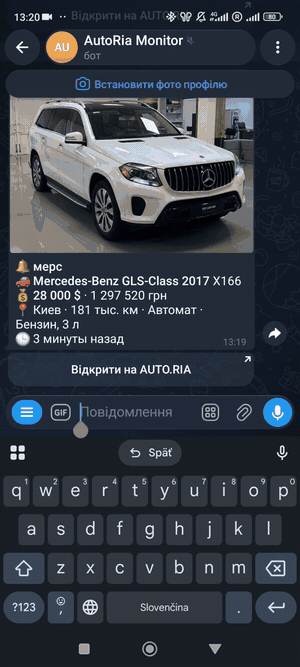
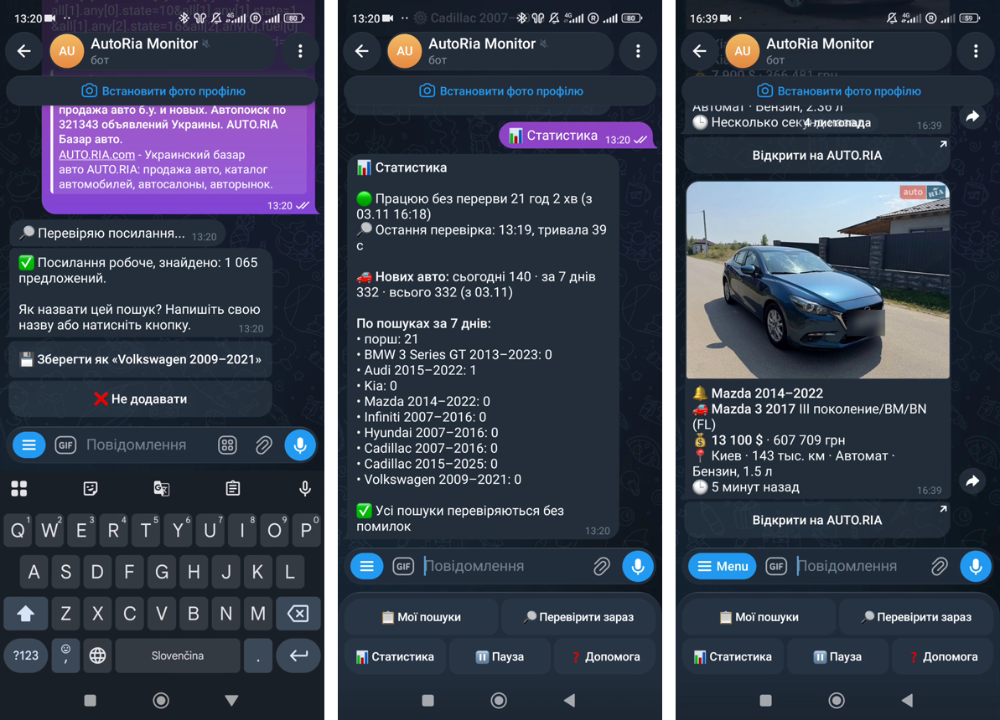

# AutoRia Monitor

[](https://github.com/niapard-commits/autoria-monitor/actions/workflows/tests.yml)


A Telegram bot that watches searches on [AUTO.RIA](https://auto.ria.com), Ukraine's
largest car marketplace, and sends every new listing to Telegram within minutes:
photo, price, mileage, city and a button to the listing.

Built to a real Upwork job post: *"a bot that monitors a website for new listings
and sends alerts via Telegram. Reliable, simple, minimal ongoing maintenance."*

<p align="center"></p>



> The bot's interface is in Ukrainian (the target users are in Ukraine).
> Licence plates in the screenshots are blurred.

## Features

- **Set up with the site's own filter.** Configure a search on AUTO.RIA, send the
  link, and the bot checks it and suggests a name such as "Volkswagen 2009–2021".
- **Unlimited searches**, managed only with buttons: open, rename, delete, pause,
  check now, statistics.
- **Each car arrives exactly once**, even if it matches several overlapping
  searches and even after a restart.
- **Checks every 5 minutes, 24/7**, as a systemd service that restarts after
  crashes and reboots.
- **Fails loudly, not silently.** Timeouts, blocking (403/429), dead links (404),
  server errors and site layout changes each produce a plain-language warning.
  It warns only after 3 failures in a row, warns once, and reports when things
  are back to normal.
- **Private.** It answers only its owner's chat ID.

## How it works

```
autoria_parser.py  downloads a search page and extracts listings
storage.py         SQLite: searches, seen listings, stats, pause state
monitor.py         decides what is new and formats the alert card
bot.py             Telegram UI, dialogs and the scheduled check loop
```

Design decisions:

- **Reads the page's internal state (`window.__PINIA__`), not the HTML layout.**
  A redesign of the site doesn't break the bot. Only the real results block is
  used, so ads, "offer of the day" and "similar offers" are never sent as new
  cars. A naive scraper counted 27 cars on a page that had 20.
- **"New" means an ID this search has never seen,** not "first on the page", so
  bumped old listings are ignored.
- **Catch-up after downtime.** If the whole first page is new, the bot reads up to
  5 pages so nothing is lost. After an 8-hour outage it delivered 82 alerts with
  no duplicates.
- **Health check.** If the page loads but has 0 listings while the site says
  "2,650 offers", that is treated as a breakage, not as "nothing new".
- **No lost alerts.** A listing is marked as seen only after Telegram confirms
  delivery.
- **Polite to the site:** pauses between requests and a minimum check interval.
- **Swappable data source.** The official RIA API's free tier (1,000 requests a
  month) is far below what one search checked every 5 minutes needs (~8,640), so
  the bot reads public pages. Switching to the paid API would change only
  `autoria_parser.py`.

## Tests

```bash
python -m pytest -q
```

97 tests run offline in about 2 seconds. They cover:
- the parser, on saved real pages;
- simulated site outages, no internet and Telegram rejecting a photo;
- long downtime and catch-up;
- the add and rename dialogs in chat.

GitHub Actions runs them on every push.

## Run it

Requires Python 3.11+.

```bash
git clone https://github.com/niapard-commits/autoria-monitor.git
cd autoria-monitor
python -m venv venv
venv/bin/pip install -r requirements.txt    # Windows: venv\Scripts\pip
cp .env.example .env                        # add your bot token and chat ID
venv/bin/python bot.py
```

- **Token:** get it from [@BotFather](https://t.me/BotFather).
- **Chat ID:** get it from [@userinfobot](https://t.me/userinfobot).
- **Never commit `.env`.** It is already in `.gitignore`.

To run it 24/7 on a Linux server, see [`deploy/autoria-bot.service`](deploy/autoria-bot.service):

```bash
sudo cp deploy/autoria-bot.service /etc/systemd/system/
sudo systemctl daemon-reload
sudo systemctl enable --now autoria-bot
```

Tested in production: the bot came back online 16 seconds after a server reboot.

## Limitations

- Only AUTO.RIA. Another site needs its own parser module; the rest of the bot stays the same.
- Only Telegram. WhatsApp would need the paid WhatsApp Business API.
- If AUTO.RIA changes its page structure significantly, the parser needs an
  update. The bot detects this and tells the owner.

## Docs in Ukrainian (for the client)

- [`README.uk.md`](README.uk.md): user guide, what the client provides, technical setup
- [`REPORT.md`](REPORT.md): delivery report, what was built and how it was verified

---

**Need a similar bot for another site?** Order or ask a question via [my Fiverr gig](https://www.fiverr.com/serhii_bots/build-a-custom-python-telegram-bot).
